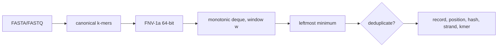

# minimizer-stream

[](https://github.com/bmouler/minimizer-stream/actions/workflows/ci.yml)


[](LICENSE)

A dependency-free Python library and command-line program that streams canonical minimizer sketches from FASTA and four-line FASTQ. Output includes record, zero-based position, stable 64-bit FNV-1a hash, canonical strand, and canonical k-mer.

## Install

```bash
python -m pip install minimizer-stream
```

For development and verification:

```bash
python -m pip install -e '.[test]'
ruff check .
pytest --cov=minimizer_stream --cov-branch --cov-fail-under=100
```

## Quickstart

```bash
minimizer-stream reads.fasta -k 21 -w 10 > sketch.tsv
minimizer-stream reads.fastq -k 21 -w 10 --format jsonl --deduplicate
cat reads.fasta | minimizer-stream - -k 15 -w 5
```

TSV has no header and its columns are `record`, `position`, `hash`, `strand`, `kmer`. JSONL uses the same field names. The Python API is lazy:

```python
from minimizer_stream import minimizers, naive_minimizers

for item in minimizers("ACGTTGCA", k=3, w=2, deduplicate=True):
    print(item.position, item.hash, item.strand, item.kmer)

assert list(minimizers("ACGTTGCA", 3, 2)) == list(naive_minimizers("ACGTTGCA", 3, 2))
```

## Algorithm



The general iterable path compares each k-mer lexicographically with its reverse complement; the exact-string `k=21` path instead maintains equivalent rolling two-bit forward and reverse encodings and materializes strings only for selected minima. Palindromes stay on the forward strand. Canonical values are hashed with deterministic 64-bit FNV-1a, never Python's process-randomized `hash`. A monotonic deque retains possible minima for each window, removing expired entries from the front and strictly larger hashes from the back. Keeping equal hashes preserves the documented leftmost tie-break.

The general iterable path constructs, reverse-complements, and hashes each canonical k-mer in $O(k)$, for $O(nk)$ total time and $O(w+k)$ working memory. The exact-string `k=21` path keeps packed rolling state, so its fixed-width work is $O(n)$ with $O(w)$ per-call memory; the four-base FNV transition table is immutable module state. `naive_minimizers` remains the executable $O(n(k+w))$ oracle. Non-ACGT characters reset both k-mer construction and the minimizer window, so no output spans an invalid base.

## Reproducible capability evidence

`PYTHONPATH=src python benchmarks/benchmark.py --json` parses 16 deterministic FASTA/FASTQ
records totaling 128,000 bases, streams canonical `k=21`, `w=100` minimizers with
deduplication, and materializes 2,220 ordered objects. It refuses to time results that differ
from `naive_minimizers`.

On an Apple M3 Max with CPython 3.11.12 on 2026-08-15, 11 samples after two warmups measured
frozen baseline `5d37de9d4ff4` at **307.803 ms** median and the packed rolling implementation
at **143.045 ms**, a **2.152x speedup**. Both runs produced SHA-256
`faaba963089826ffa15afd9f9d9e0d63e3dd5d6de96ea6a3632743fb000fb008`. Fixture
generation and interpreter startup are excluded; record parsing, minimizer generation, and
output materialization are included. These are local in-process timings; rerun with
`PYTHONPATH` pointed at the desired source worktree.

## Verification

CI runs Ruff, strict mypy, and the full property-based and deterministic test suites on Linux and macOS with Python 3.11–3.13. Its exact coverage command is:

```bash
pytest --cov=minimizer_stream --cov-branch --cov-fail-under=100
```

Tests include reverse complements, palindromes, ties, invalid-base resets, short and lowercase sequences, FASTA, FASTQ, malformed records, invalid parameters, subprocess execution from a clean temporary directory, TSV, JSONL, standard input, and deduplication.

### Mutation testing

From the repository root, reproduce the mutation run with:

```bash
source .venv/bin/activate
mutmut run
mutmut results
```

Mutation testing generated 392 mutants and killed 388 (98.98%). The remaining 4 survivors were reviewed as behavior-equivalent, not missed mutants; the run had zero suspicious mutants and zero timeouts.

| Behavior-equivalent rationale | Count |
|---|---:|
| ASCII codec alias | 1 |
| Initial `None` versus empty value, compared only to `Minimizer` instances | 2 |
| `typing.cast` is an identity operation at runtime | 1 |

## Limitations

- FASTQ must use the conventional four-line form; wrapped sequence or quality lines are rejected.
- FASTA permits wrapped sequence lines but rejects blank lines and empty records.
- Record names containing control characters or beginning with `=`, `+`, `-`, or `@` are rejected so default TSV output keeps five columns and is safe from spreadsheet formula interpretation.
- Input is decoded as ASCII; compressed files must be decompressed before use.
- Record sequences are retained one at a time. The parser does not load the full file, but an individual record must fit in memory.
- `w` counts consecutive valid k-mers, not bases. A valid window therefore spans `k + w - 1` bases.
- Hash collisions are possible for any 64-bit sketch; the canonical k-mer is emitted so callers can distinguish them when needed.
